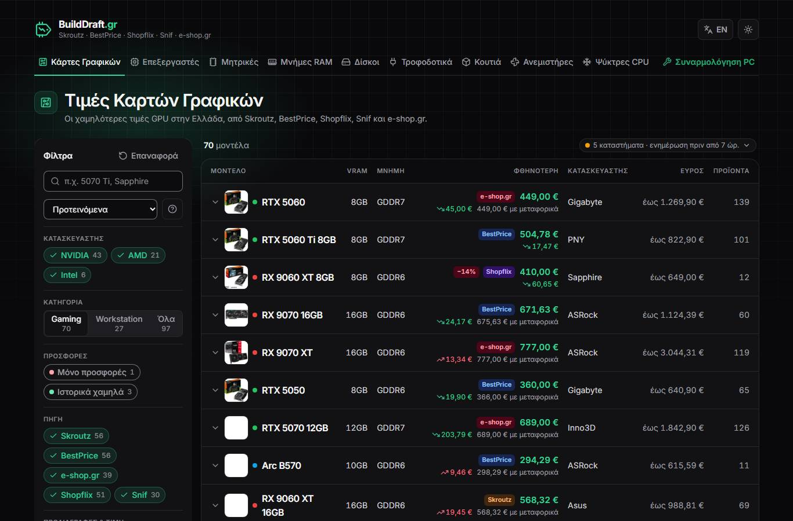
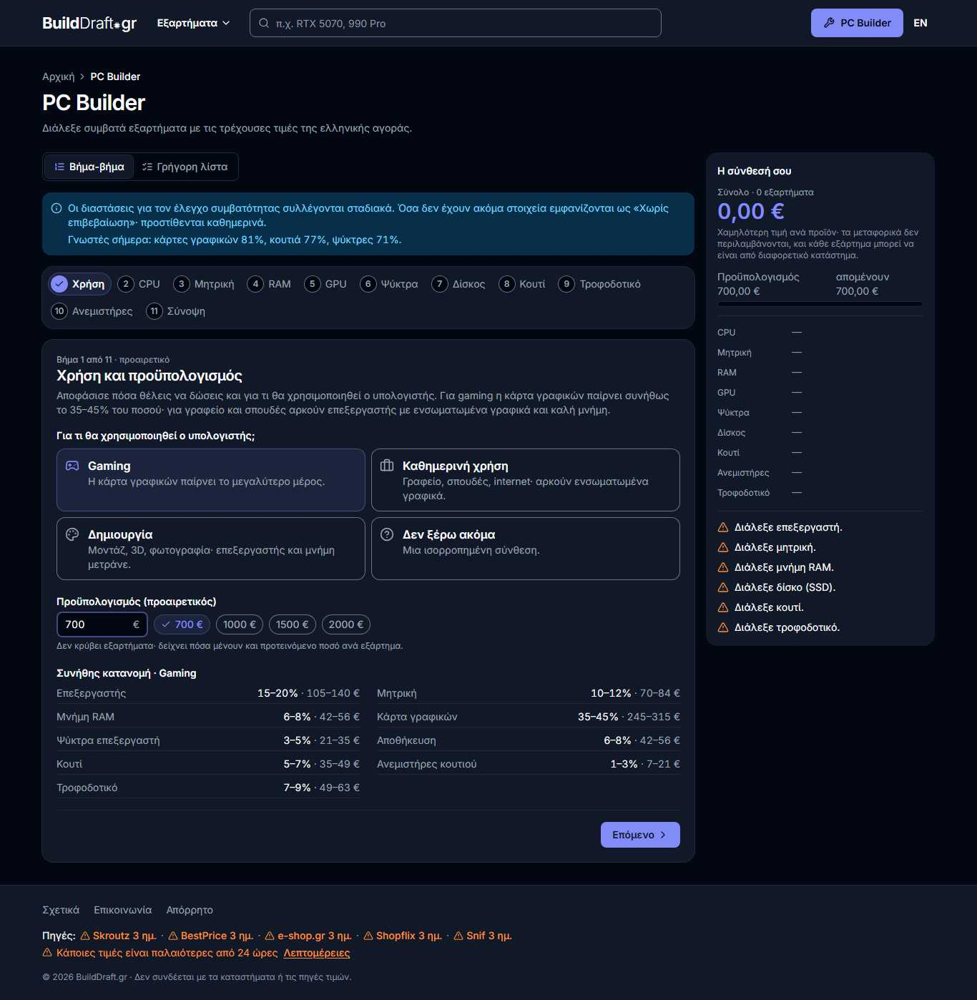
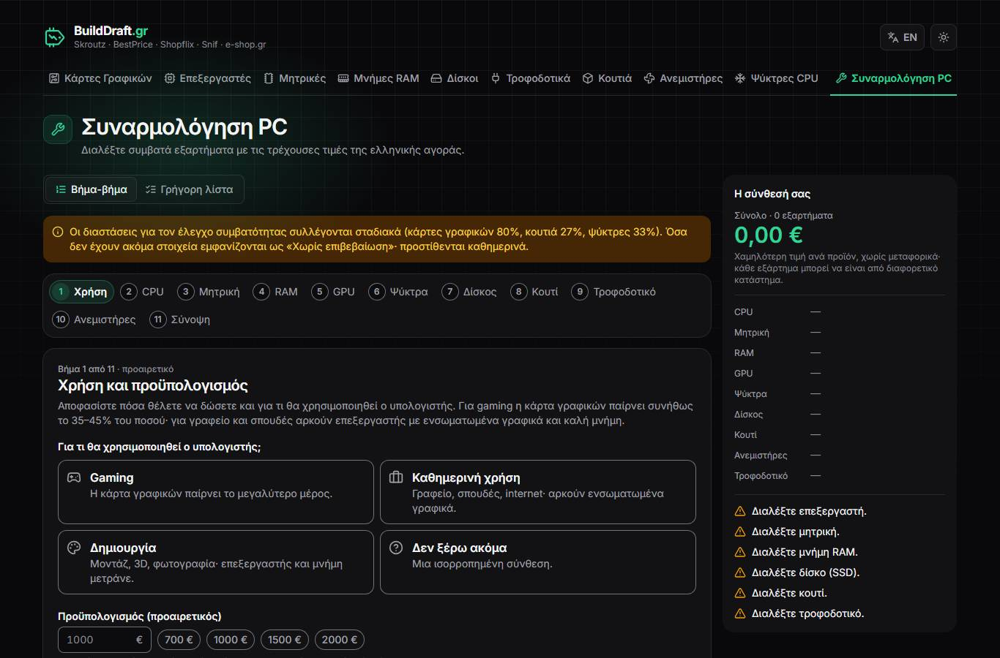
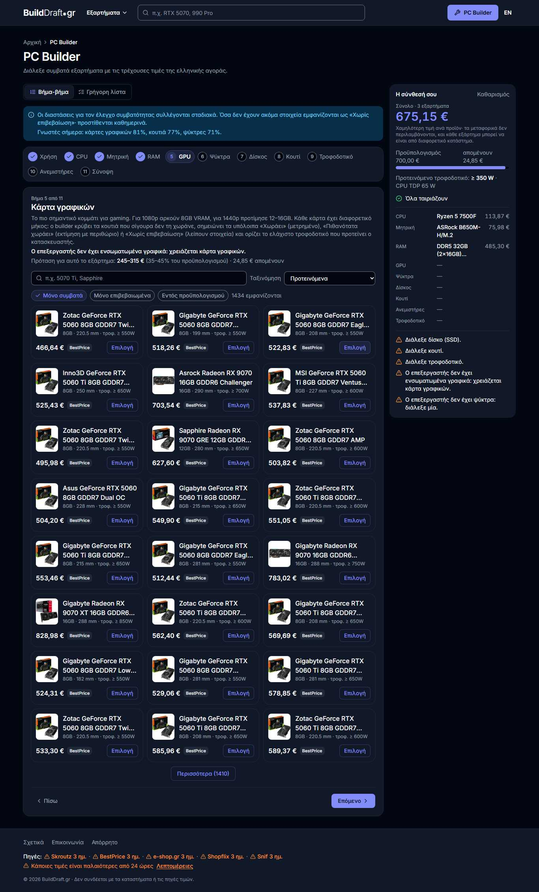
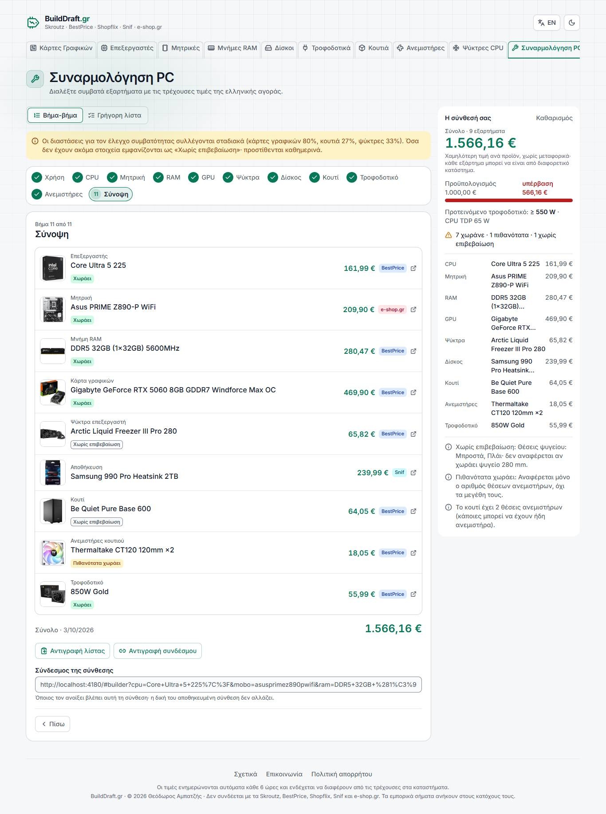
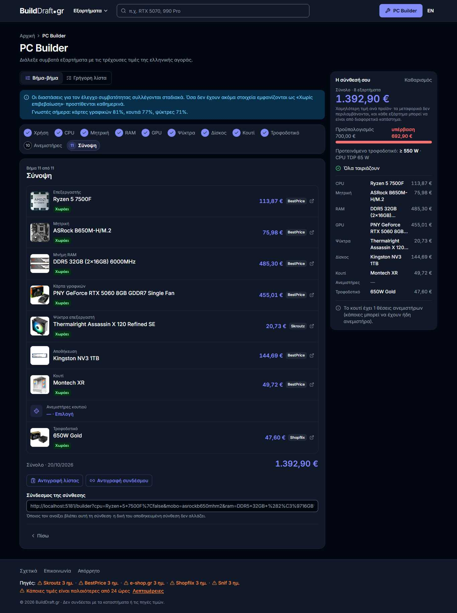
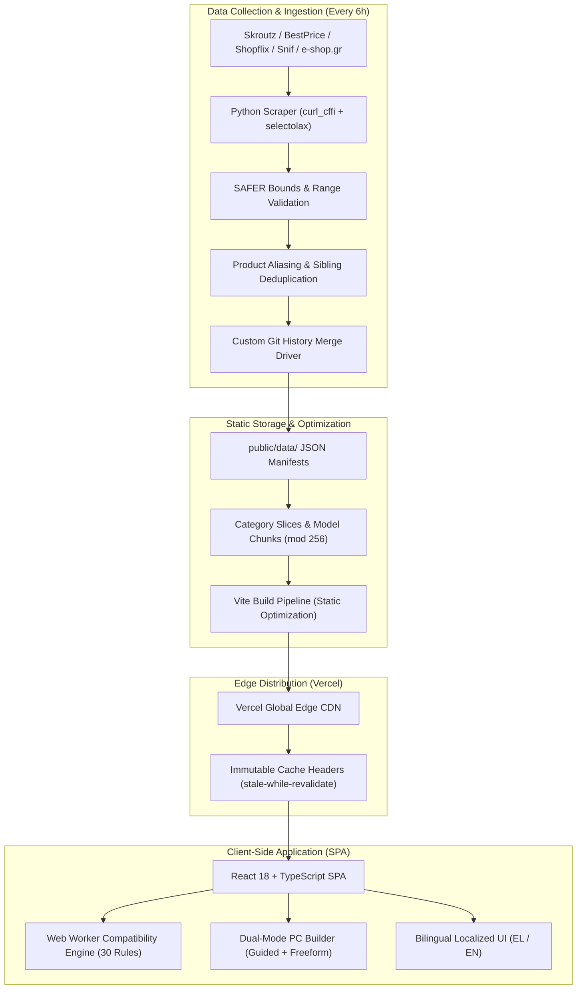

# BuildDraft.gr (v2.0)

<p align="center">
  <strong>Automated PC hardware price aggregation, merchant intelligence, and deterministic hardware compatibility engine for the Greek market.</strong>
</p>

<p align="center">
  <a href="https://gpu-prices-gr.vercel.app"></a>
  <a href="LICENSE"></a>
  <a href="https://github.com/TeoAmpatzis/gpu-prices-gr/actions/workflows/scrape.yml"></a>
  
  
</p>

<p align="center">
  <a href="#-key-features">Key Features</a> •
  <a href="#-whats-new-in-v20-v1-vs-v2">What's New in v2.0</a> •
  <a href="#-system-architecture">Architecture</a> •
  <a href="#-compatibility-engine">Compatibility Engine</a> •
  <a href="#-tech-stack">Tech Stack</a> •
  <a href="#-quickstart--local-development">Quickstart</a> •
  <a href="#-changelog--docs">Docs</a>
</p>

---

## ⚡ Overview

**BuildDraft.gr** is an open-source, serverless web platform designed to solve PC building and price tracking for Greek consumers. By aggregating real-time prices from **Skroutz, BestPrice, Shopflix, Snif, and e-shop.gr**, BuildDraft surfaces true market lows, shipping costs, and price history trends across 9 hardware categories.

Built on an ultra-lean **Static-Edge architecture**, the application requires zero operational database infrastructure. Automated Python workers scrape and normalize merchant data every 6 hours on GitHub Actions, emitting hash-chunked JSON artifacts directly consumed by a high-performance React + TypeScript SPA hosted on Vercel's global edge network.

---

## 🌟 Key Features

- **Multi-Retailer Price Tracking**: Compares live offers across major Greek marketplaces (Skroutz, BestPrice, Shopflix, Snif, e-shop.gr), ranking items by true total cost (product price + shipping).
- **Historical Price Trends & Dips**: Tracks 7-day price fluctuations, all-time lows, and retailer promotional tags.
- **Dual-Mode PC Builder**:
  - **Guided Walkthrough**: Tailored component recommendations dynamically adapted to target budget and use case (Gaming, Workstation, Office).
  - **Freeform Workbench**: Flexible part-list builder with instant hardware verification, live power tally, and shop grouping.
- **Industrial Compatibility Engine**: 30 deterministic rules validating physical clearances (GPU length, cooler height, case radiator support), electrical demands (GPU TGP, CPU PL2/PPT), and motherboard chipset/BIOS matching.
- **Stateless Build Sharing & Export**: Compressed URL sharing (`/builder?b=...`), localStorage auto-recovery, and one-click Markdown clipboard export for tech forums, Reddit, and Discord.
- **Zero-DB Edge Performance**: Critical first load < 100 KB gzip, Progressive Hash Chunks (mod 256), CLS = 0.000, and 95–100 Lighthouse rating on mobile.
- **Bilingual & Responsive**: Full Greek (EL) and English (EN) localization with a sleek, dark-first design system responsive from 360px smartphones to 4K displays.

---

## 🚀 What's New in v2.0 (v1 vs v2)

Version 2.0 is a complete generational leap over v1.0, re-architecting the application from the ground up for speed, reliability, and precision engineering.

| Feature / Metric | BuildDraft v1.0 (Legacy) | BuildDraft v2.0 (Current) |
| :--- | :--- | :--- |
| **Hardware Verification** | Basic string matching (socket only) | **30 Deterministic Rules** + official vendor spec matrices (power curves, dimensions, BIOS, lanes). |
| **PC Assembly Flow** | Rigid linear form | **Dual-Mode**: Guided intent/budget builder + Freeform Part List Workbench. |
| **Recommendation Engine** | Naive sorting by price | **Intelligent Tier Balancing** scoring components by budget proportion and workload. |
| **Data Integrity Layer** | Direct scraper output | **`SAFER` Ingestion Guard** rejecting abnormal dimensions and resolving merchant naming collisions. |
| **System Power Modeling** | Static nominal wattage | **Dynamic Load Modeling** (CPU PL2/PPT limits + GPU TBP + ATX 3.0/3.1 12V-2x6 checks). |
| **Build Sharing** | Unstable hash strings | **Compact State Compression** (`/builder?b=...`) + Markdown export + auto-save. |
| **Asset Delivery** | Monolithic multi-MB JSON files | **Progressive Hash Chunks** (<25 KB gzip per category slice mod 256). |
| **Quality Assurance** | Basic smoke checks | **1,440+ Automated Tests** across 55 suites (100% pass) + 81 compatibility benchmarks. |

### 📸 Visual Comparison

#### 1. Hardware Catalog & Filtering
| Version 1.0 (Legacy Catalog) | Version 2.0 (Modern Catalog) |
| :---: | :---: |
|  |  |
| *Dense tables with basic text filtering.* | *Modern dark-first cards, fast facet filtering, and availability badges.* |

#### 2. PC Builder & Guided Recommendations
| Version 1.0 (Linear Form) | Version 2.0 (Smart Recommendations) |
| :---: | :---: |
|  |  |
| *Rigid step progression without budget guidance.* | *Budget allocation, tier recommendations, and contextual warnings.* |

#### 3. Freeform Workbench & Comprehensive Compatibility Review
| Version 1.0 (Simple Summary) | Version 2.0 (Deep Compatibility & Multi-Shop Review) |
| :---: | :---: |
|  |  |
| *Basic list without clearance verification.* | *30-point physical & electrical validation with per-shop checkout breakdown.* |

> Detailed technical migration notes and analysis can be found in [docs/v1-to-v2-evolution.md](docs/v1-to-v2-evolution.md).

---

## 🏗️ System Architecture

BuildDraft utilizes a decoupled static-first architecture. It combines automated serverless scraping pipelines with high-speed static edge distribution:



---

## ⚙️ Compatibility Engine

The deterministic compatibility engine (`src/engine/rules.ts`) evaluates component pairings against 30 strict hardware constraints:

1. **Physical Clearances**:
   - `Rule 1`: GPU length vs. Case maximum clearance.
   - `Rule 2`: CPU cooler height vs. Case maximum cooler clearance.
   - `Rule 3`: Motherboard form factor (E-ATX, ATX, Micro-ATX, Mini-ITX) vs. Case support.
   - `Rule 4`: Radiator sizing (120/240/280/360 mm) vs. Case top/front mounting brackets.
2. **Electrical & Power Safety**:
   - `Rule 14`: Estimated system load calculation (GPU TGP/TBP + CPU PL2/PPT + 100W peripheral overhead) vs. PSU rated continuous wattage.
   - `Rule 15`: PSU form factor compatibility (SFX, SFX-L, ATX) vs. Case mounting.
   - `Rule 16`: High-power GPU connector validation (ATX 3.0 / 3.1 12V-2x6 & 12VHPWR native vs. adapter requirements).
3. **Architecture & Chipsets**:
   - `Rule 5`: CPU socket vs. Motherboard socket (AM4, AM5, LGA1700, LGA1851).
   - `Rule 13`: Chipset generation compatibility and BIOS flashback necessity.
   - `Rule 25`: Memory generation (DDR4 vs. DDR5) and official CPU native memory speed bounds.
   - `Rule 27-30`: Hardware balance scoring (preventing extreme bottlenecks like low-end CPUs paired with flagship GPUs).

All engine rules are benchmarked continuously against **81 real-world scenarios** in `tests/compat/engine-scenarios.test.ts`.

---

## 🛠️ Tech Stack

- **Frontend Core**: [React 18](https://react.dev/), [TypeScript 5.6](https://www.typescriptlang.org/), [Vite 5](https://vitejs.dev/)
- **Styling & UI**: [Tailwind CSS 3.4](https://tailwindcss.com/), [Lucide React](https://lucide.dev/)
- **Scraper & Pipeline**: [Python 3.12](https://www.python.org/), [curl_cffi](https://github.com/yifeikong/curl_cffi), [selectolax](https://github.com/rushter/selectolax)
- **Quality Assurance**: [Vitest 3](https://vitest.dev/), [Playwright](https://playwright.dev/), [ESLint 9](https://eslint.org/)
- **Hosting & CI/CD**: [GitHub Actions](https://github.com/features/actions), [Vercel Edge Network](https://vercel.com/)

---

## 💻 Quickstart & Local Development

### Prerequisites
- **Node.js** >= 20.x
- **npm** >= 10.x
- **Python** >= 3.12 (optional, required only for running the local scraper)

### 1. Web Application

```bash
# Clone the repository
git clone https://github.com/TeoAmpatzis/gpu-prices-gr.git
cd gpu-prices-gr

# Install dependencies
npm install

# Start development server (http://localhost:5173)
npm run dev

# Run comprehensive test suite (1,440+ tests)
npm test

# Run type checking
npm run typecheck

# Production build preview
npm run build
npm run preview
```

### 2. Scraper Execution (Optional)

```bash
# Set up Python virtual environment
python -m venv venv
venv/Scripts/activate  # On Windows: venv\Scripts\activate | On Unix: source venv/bin/activate

# Install scraper dependencies
pip install -r scraper/requirements.txt

# Run scraper for a single category (e.g. GPU)
python scraper/main.py --category gpu

# Run full multi-category scraper
python scraper/main.py
```

---

## 📂 Project Structure

```text
├── .github/workflows/       # Automated 6h scraper cron & history sync workflows
├── docs/
│   ├── assets/              # Curated v1 & v2 screenshots and media
│   └── v1-to-v2-evolution.md# Detailed technical migration analysis
├── public/data/             # Static JSON pricing database, models, and history
├── scraper/                 # Python scraping engine, SAFER validation, normalizers
├── src/
│   ├── components/
│   │   └── builder/         # Guided & Freeform PC builder components
│   ├── engine/              # Hardware compatibility engine (Rules 1-30 & spec tables)
│   ├── lib/                 # Core utilities, filtering, state management, formatting
│   └── shell/               # Navigation, global search, layout, bilingual strings
├── tests/
│   ├── compat/              # 81 compatibility benchmark scenario suites
│   ├── e2e/                 # Playwright end-to-end user journey tests
│   └── unit/                # 1,400+ Vitest unit tests
├── CHANGELOG.md             # Semantic version history
└── vercel.json              # Edge rewrites, route rules, and immutable caching
```

---

## 📄 License & Legal Notice

Code distributed under the [PolyForm Noncommercial 1.0.0](LICENSE) license.

- **Non-Commercial Use**: Free for personal use, education, research, and inspection.
- **Commercial Use**: Commercial deployment or use in revenue-generating services requires prior written permission from the author.
- **Brand & Identity**: The name *BuildDraft*, logos, and visual marks are protected and may not be used without authorization.

### Data & Trademarks
All product names, logos, prices, and retailer trademarks (Skroutz, BestPrice, Shopflix, Snif, e-shop.gr) are the property of their respective owners. BuildDraft.gr is an independent aggregator and is not affiliated with or endorsed by any merchant or hardware vendor.

---

<p align="center">
  <strong>Crafted with care by <a href="https://github.com/TeoAmpatzis">Theodoros Ampatzis</a></strong>
</p>
