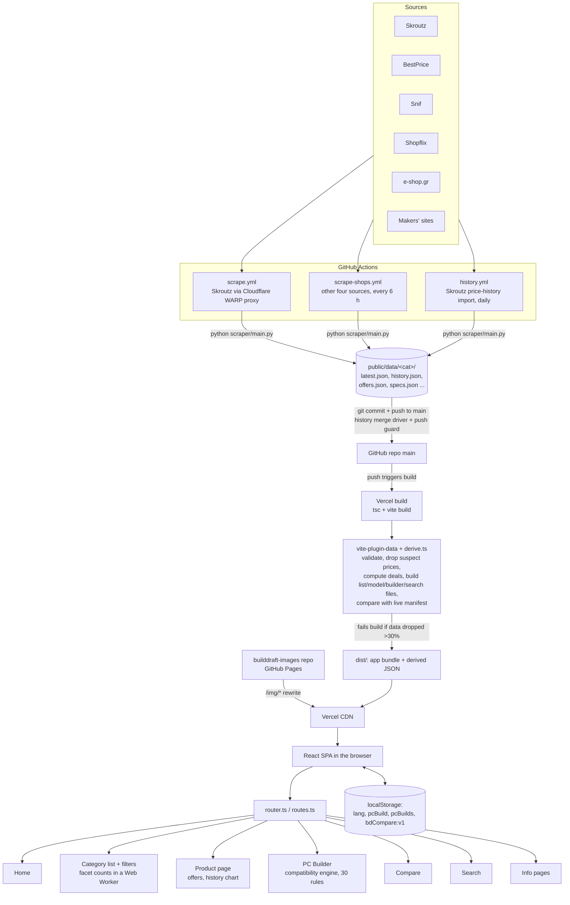

# 02 — Architecture and feature map

Audit date: 2026-11-10. Code: commit `7dcc167` (branch `fix/monitor-accessories`, equal to `origin/main`). Data: commit `ca61231` ("update prices 2026-11-10 09:49").

## Real technology stack (verified from the repository)

| Layer | What it is | Evidence |
|---|---|---|
| Frontend | Single-page app: React 18.3, TypeScript 5.9 (strict), Vite 5.4, Tailwind 3.4, lucide-react. No UI framework, no state library, no router library. | `package.json`, `src/main.tsx`, `src/lib/router.ts` |
| Backend server | **None.** No API, no server-side code, no serverless functions. | no `api/` folder; `vercel.json` has only rewrites and headers |
| Database | **None.** All data is JSON files committed to git under `public/data/<category>/`. | `public/data/`, `scraper/main.py` |
| Authentication | **None.** No accounts, no sessions, no cookies. | no auth code in `src/` |
| "Backend" in practice | Python scraper (curl_cffi, selectolax, Pillow) run by GitHub Actions on a schedule; it commits JSON to `main`. | `scraper/`, `.github/workflows/*.yml` |
| Build-time data layer | A Vite plugin turns the scraper's files into the smaller files the site downloads, and refuses to publish broken data. | `vite-plugin-data.ts`, `src/lib/derive.ts` |
| Hosting | Vercel (Hobby), static output `dist/`. Every push to `main` deploys. | `vercel.json`, CLAUDE.md |
| Photos | Separate repository served by GitHub Pages, reached through a `/img/*` rewrite. | `vercel.json`, `scraper/images.py` |
| Browser storage | `localStorage`: `lang`, `pcBuild`, `pcBuilds`, `bdCompare:v1`. | `src/lib/i18n.ts:15`, `src/lib/buildStore.ts`, `src/lib/savedBuilds.ts`, `src/lib/compare/store.ts` |
| Tests | Vitest (78 files, 1,628 tests), Playwright (24 spec files, 312 tests, Chromium only), 23 Python check scripts, ESLint 9. | `npm run check`, `tests/`, `scripts/checks/` |

Because there is no server, database or login, the audit's "backend", "API", "database", "authentication" and "authorization" phases apply only to the scraper, the data files and the build step. Those phases are reported that way, and what does not exist is listed in `13-UNVERIFIED-AREAS.md` as not applicable rather than as passed.

## Architecture

## Feature inventory and test coverage matrix

"Audit result" is what this audit observed in a real Chromium browser on the local production build (`http://localhost:4199`) unless stated otherwise.

| # | Feature | Entry point | Main code | Existing automated tests | Audit result |
|---|---|---|---|---|---|
| F1 | Home: search, category tiles, freshness, "largest price drops", ready builds | `/` | `src/shell/Home.tsx`, `src/lib/homeFile.ts` | `home.spec.ts` (10) | Works; **content problem** (P2-002, P3-008) |
| F2 | Global search with suggestions | header, `/search?q=` | `src/lib/search.ts`, `components/search/SearchPage.tsx` | `search.spec.ts` (9) | Works (J01); long input overflows (P4-003) |
| F3 | Category list, filters, URL sync, sort, pagination | `/<cat>` | `components/CategoryView.tsx`, `lib/catalogueFilters.ts`, `lib/filterUrl.ts`, `lib/facets*.ts` | `catalogue` (14), `filters` (11), `facets` (3), `urls` (52), unit tests | Works (J02, J03, E09); 4,000 URL round trips with 0 mismatches |
| F4 | Deal and "lowest" badges, "Deals only" filter | list, product page | `lib/deals.ts`, `lib/data.ts:126` | unit `deals` tests | **Bug**: 7% deals never shown (P2-001) |
| F5 | Product page: specs, offers table, price history, variants, alternatives | `/<cat>/<slug>` | `components/product/*` | `model.spec.ts` (52) | Works (J05); totals add up on every checked row |
| F6 | Compare (tray, page, share) | `/compare` | `components/compare/*`, `lib/compare/*` | `compare.spec.ts` (28) | Works (J05, E09); layout shift on phone (P3-005) |
| F7 | PC Builder: start screen, guided walk, part list, picker | `/builder` | `components/builder/*`, `lib/builderState.ts` | `builder*.spec.ts` (53), `pick` (16) | Works (J06) |
| F8 | Automatic build for a use and budget | `/builder` → "Build it for me" | `lib/autoBuild.ts` | unit `autoBuild` tests | Works, within budget, 0 incompatible; **quality flaws** (P2-003, P3-001) |
| F9 | Compatibility engine (30 rules) | builder, product page fit | `src/engine/*` | 81 scenarios + unit tests | 6,000 random builds: 0 crashes, 0 malformed messages, deterministic |
| F10 | Saved build, named builds, share link, copy list | builder | `lib/buildStore.ts`, `savedBuilds.ts`, `share.ts` | `builder.spec.ts`, `builder-recovery` (6) | Works (J06); spoofable part name (P4-004) |
| F11 | Language toggle (el/en) | header | `lib/i18n.ts` | `shell.spec.ts`, unit `i18n` | Works, persists (J04) |
| F12 | Old `#…` links redirect | `/#ram?...` | `lib/routes.ts:52` | `urls.spec.ts` | Works (E15) |
| F13 | Error and empty states, retry | everywhere | `ui/states`, `shell/ErrorBoundary.tsx` | `catalogue.spec.ts:96` | Data errors recover; **code-load error sticks** (P2-004) |
| F14 | Info pages | `/about` `/contact` `/privacy` `/how-prices` | `components/InfoPage.tsx`, `content/pages.ts` | `smoke`, `links` | Works; layout shift on desktop (P3-005) |
| F15 | SEO: titles, canonical, sitemap, robots | all | `lib/pageMeta.ts`, `lib/sitemap.ts` | `seo.spec.ts` (3) | Client-side only (P3-009) |
| F16 | Scraper: 5 sources × 10 categories, shipping, specs, makers, history import | GitHub Actions | `scraper/*` | 23 Python scripts (all pass) | Code read; **not run** (see 13) |
| F17 | Build-time validation and publishing check | `vite build` | `vite-plugin-data.ts`, `derive.ts:725` | unit tests, `data-equivalence` | Ran: build passed, 143 suspect listings removed |
| F18 | Photos pipeline | images repo | `scraper/images.py` | none seen in this repo | Not tested (other repository) |
